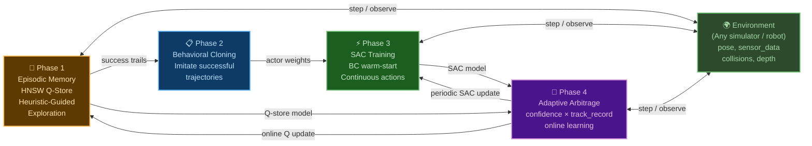

# Bio-Inspired Hybrid RL for goal-directed 3D Navigation

# Bio-Inspired Hybrid RL for 3D Object Navigation
## Abstract

We present a hybrid reinforcement learning system for goal-directed navigation on 3D object surfaces. The system combines three complementary learning mechanisms 
 - **episodic memory** (kernel-based Q-learning with HNSW nearest-neighbor search)
 - **learned skills** (Soft Actor-Critic with continuous actions)
 - **geometric heuristics** (hand-crafted domain knowledge).

**Adaptive arbitrator** selects the best action source per step based on confidence and track record.

The architecture is inspired by biological memory systems: 
- episodic memory provides one-shot learning and fast adaptation (hippocampal analogy)
- parametric policy captures generalized skills through repetition (procedural memory analogy)
- arbitrator implements a metacognitive switching mechanism between behavior modes.

We:
- validate the approach on a lightweight trimesh simulator across different object geometries
- demonstrate sim-to-sim transfer to MuJoCo with real YCB objects (no retraining)
- present a case study integrating the system with the Thousand Brains Project's Monty framework for object recognition.
  
Key results:
- **91% average navigation success** on trimesh across three difficulty levels and objects (sphere, thin_cylinder, cylinder, cube, vase, flat_square, cone, mug, cup)
- **81% success on unseen complex hollow objects (cup)** (zero-shot generalization)
- **74% success on YCB objects** (Banana, Cracker Box, Master Chef Can, Bowl, Mug) in MuJoCo without fine-tuning.
---

## 1. Introduction

### The Problem

Many robotic and cognitive systems require an agent to navigate along 3D object surfaces toward specific goal locations.
Realistic navigation introduces challenges:

- **Surface geometry is complex.** Objects have edges, rims, concavities, and thin walls. An agent must crawl along curved surfaces, detect and traverse edges, detach from surfaces when necessary, fly through air, and land on target surfaces — all without a map.

- **Goals may be unreachable by direct paths.** When the goal is on the opposite side of an object, the agent must plan a multi-phase trajectory: crawl to an edge, detach, fly around, and land. No single behavior suffices.

- **Learning must be fast.** A robot encountering a new object cannot afford thousands of failed episodes before achieving basic navigation. The system needs one-shot or few-shot adaptation.

- **The system must be robust.** In deployment, the agent faces sensor noise, imprecise actuation, and objects never seen during training. Graceful degradation and online adaptation are essential.

### Our Approach

We propose a hybrid RL system that mirrors how biological agents learn motor skills:

1. **Episodic memory first.** Like a child learning to navigate, the system starts by remembering specific experiences: "In *this* situation, *this* action worked." A kernel-based Q-learning algorithm with HNSW nearest-neighbor storage provides one-shot learning and fast retrieval. This is analogous to hippocampal episodic encoding.

2. **Skills through repetition.** Successful episodic experiences are distilled into a parametric policy (SAC) via behavioral cloning, then refined through reinforcement learning. This is analogous to the transition from declarative to procedural memory — from "I remember turning left here" to "I automatically turn left in situations like this."

3. **Adaptive arbitration.** A metacognitive layer decides per step whether to trust episodic memory, learned skills, or geometric heuristics, based on confidence estimates and rolling track records. This is analogous to the brain's ability to switch between habitual and deliberate behavior depending on familiarity and stakes.

4. **Environment-agnostic design.** The state representation uses only relative geometric features (direction to goal, surface normal, curvatures) in the agent's local frame. This enables policies trained in one simulator to transfer to another — or to a real robot — without retraining.

### Contributions

- A **hybrid RL architecture** combining episodic memory (HNSW Q-store), parametric policy (SAC), and geometric heuristics with adaptive arbitration
- A **frame-invariant 22D state representation** that enables zero-shot sim-to-sim transfer
- A **phase-driven navigation system** with six behavioral phases and strategic/tactical decision hierarchy
- **Experimental validation** on 9 geometric primitives, 5 YCB objects, and integration with the Thousand Brains Project's Monty recognition system
- **Open-source implementation** with modular environment protocol enabling deployment on any simulator or robot

---

## 2. Biological Motivation

### Memory Systems in the Brain

The architecture draws explicit parallels to three biological memory systems:

| Brain System | Function | Algorithm Analog |
|-------------|----------|-----------------|
| **Hippocampal episodic memory** | Store and retrieve specific experiences by similarity | HNSW + kNN + Gaussian kernel Q-learning |
| **Basal ganglia / procedural memory** | Automated skills learned through repetition | Soft Actor-Critic (SAC) parametric policy |
| **Prefrontal arbitration** | Switch between habitual and deliberate behavior | Adaptive arbitrator with confidence × track record |

### Why Episodic Memory Matters for RL

Standard deep RL learns slowly — thousands of episodes to converge. Biological agents learn from single experiences. The episodic memory component provides:

- **One-shot / few-shot learning**: A single successful navigation is stored and can be retrieved when a similar situation arises
- **Pattern completion**: kNN retrieval from partial state matches (analogous to hippocampal pattern completion)
- **Kernel generalization**: Smooth interpolation across similar experiences via Gaussian kernels
- **Non-parametric growth**: Memory grows with experience, no fixed capacity (analogous to ongoing hippocampal neurogenesis)

### Theoretical Foundations

- **Ormoneit & Sen (2002)**, *Kernel-Based Reinforcement Learning*: Proposed and analyzed Q-learning with kernel regression approximation for large state spaces, establishing convergence conditions for non-parametric Q-function approximation.
- **Blundell et al. (2016)**, *Model-Free Episodic Control*: Demonstrated that agents remembering past successful actions and reproducing them in similar states can match or exceed deep RL performance with orders of magnitude fewer samples.

### The Learning Progression

The system follows a biologically plausible learning progression:

```
Phase 1: Episodic Memory (hippocampal)
  "I've been in a similar situation before. What did I do? What happened?"
  → HNSW Q-store with heuristic-guided exploration
  → One-shot learning, high locality, poor generalization

Phase 2: Behavioral Cloning (imitation)
  "Let me practice what worked before."
  → Extract successful trajectories → supervised learning
  → Bridge from discrete episodic to continuous parametric

Phase 3: Skill Refinement (procedural)
  "I've done this many times — I can do it smoothly now."
  → SAC with BC warm-start → continuous optimization
  → Slow learning, high generalization

Phase 4: Adaptive Deployment (prefrontal)
  "Which strategy should I use right now?"
  → Arbitrator: confidence × track_record → best source per step
  → Online learning continues in all systems
```

---

## 3. Architecture

### Overview



### Environment Protocol

The system defines a minimal environment interface that any simulator or robot must implement:

```python
class RLEnvironment(Protocol):
    def reset() -> sensor_data
    def get_pose() -> [x, y, z, rx, ry, rz]       # any consistent frame
    def get_sensor_data() -> {normal, depth, curvatures, on_object, ...}
    def set_goal(goal_pose)
    def get_random_surface_point() -> goal_pose
    def step_discrete(action_idx) -> sensor_data    # for Q-store / heuristic
    def step_continuous(type, params) -> sensor_data # for SAC
```

Currently implemented:
- **LightweightEnv** (trimesh) — fast geometric simulation, used for training
- **MuJoCoEnvAdapter** — physics-based simulation, used for evaluation and online adaptation

Future environments (Habitat, real robot) only need to implement this protocol.

---

## 4. State Representation (22D)

The agent observes a 22-dimensional state vector computed entirely in the **agent's local coordinate frame**. This frame-invariance is critical: navigating from A to B requires the same actions regardless of absolute position in the world, enabling zero-shot transfer across environments.

### Five Feature Groups

**Where is the goal?** Position error (3D direction), rotation error (3D), scalar distance. These tell the agent "the goal is 30mm ahead and to the left."

**What surface am I on?** Surface normal (3D), principal curvatures (k1, k2), on_object flag, normalized depth. These tell the agent "I'm on a curved wall" or "I'm in the air."

**How is the goal oriented relative to the surface?** Alignment — dot product of goal direction and surface normal. Negative means the goal is behind the surface (agent needs to detach). Positive means the agent can crawl along the surface.

**Goal surface context.** Goal normal in agent's local frame, path_blocked flag, movement efficiency (net displacement / total movement — detects oscillation).

**Projected goal direction.** 2D projection of goal direction onto the tangent plane (on surface) or agent XY plane (in air). Direct signal for which direction to move.

### Full State Vector

| Index | Feature | Description |
|-------|---------|-------------|
| 0–2 | position_error [x, y, z] | Direction to goal in agent's local frame |
| 3–5 | rotation_error [pitch, yaw, roll] | Orientation error (normalized angles) |
| 6–8 | local_normal | Surface normal in agent's local frame |
| 9 | k1 | Principal curvature (max absolute) |
| 10 | k2 | Principal curvature (min absolute) |
| 11 | on_object | Whether sensor is on object surface |
| 12 | alignment | dot(goal_direction, surface_normal) |
| 13 | distance | Euclidean distance to goal |
| 14 | norm_depth | Normalized depth to nearest surface |
| 15–17 | goal_normal_local | Goal surface normal in agent's local frame |
| 18 | path_blocked | Whether direct path to goal is blocked (0/1) |
| 19 | movement_efficiency | Net displacement / total movement (0..1) |
| 20–21 | projected_goal_2d | Goal direction projected onto tangent plane |

### Strategic State Vectors

In addition to the 22D tactical state, the system uses two compact 5D strategic state vectors for high-level phase transition decisions. These are stored in separate HNSW graphs and control behavioral mode switching rather than individual actions.

**Detach Decision State (5D)** — Should the agent stay on surface or lift off?

| Index | Feature | Description |
|-------|---------|-------------|
| 0 | normal_agreement | dot(agent_normal, goal_normal) — same side? |
| 1 | alignment | dot(goal_direction, agent_normal) — reachable by crawling? |
| 2 | norm_distance | distance / object_extent — relative distance |
| 3 | path_blocked | Direct path blocked? (0/1) |
| 4 | movement_efficiency | Recent crawl efficiency — detects stagnation |

**Direction Decision State (5D)** — In air: fly directly to goal or bypass obstacle?

| Index | Feature | Description |
|-------|---------|-------------|
| 0 | lateral_deviation | How far off-axis the goal is (0=ahead, 1=side) |
| 1 | alignment | dot(goal_direction, agent_normal) |
| 2 | norm_distance | distance / object_extent |
| 3 | angle_to_goal | dot(forward, goal_direction) |
| 4 | path_blocked | Direct path blocked? (0/1) |

> The strategic states are intentionally compact (5D vs 22D). High-level decisions like "should I detach?" depend on a few geometric relationships, not fine-grained curvature. Compact states mean faster learning with fewer samples and better generalization across objects.

---

## 5. Action Space (24D)

The agent selects from 24 discrete actions in four categories:

### Surface Movement
| Index | Action | Description |
|-------|--------|-------------|
| 0–7 | MoveTangentially (8 directions) | Crawl along surface: 0°, 45°, ..., 315° |
| 16 | OrientHorizontal | Position/orientation correction in horizontal plane |
| 17 | OrientVertical | Position/orientation correction in vertical plane |

### Free Movement
| Index | Action | Description |
|-------|--------|-------------|
| 8 | MoveForward | Fly forward (8mm) |
| 9 | MoveForward (backward) | Fly backward (2mm) |
| 19 | MoveForward (small) | Fly forward small step (2mm) |

### Orientation
| Index | Action | Description |
|-------|--------|-------------|
| 10–11 | TurnLeft / TurnRight | Yaw rotation (5°) |
| 12–13 | LookUp / LookDown | Pitch rotation (5°) |
| 14–15 | SetSensorRotation ±  | Roll rotation |
| 20–23 | Big rotations (up/down/left/right) | Coarse correction (15°) |

### Macro Actions
| Index | Action | Description |
|-------|--------|-------------|
| 18 | Detach | Lift off surface along normal, orient toward goal |

### Action Space Progression

The system uses actions at two levels of abstraction:

1. **Q-learning (discrete)**: Policy outputs index 0–23 with fixed step parameters. "What to do" at the primitive level.
2. **SAC (continuous parameters)**: Policy outputs action type + continuous parameters. The 8 tangential directions collapse into one action with continuous angle and distance. "What to do, and exactly how much."

This progression mirrors biological motor learning: first discrete choices ("turn left"), then continuous refinement ("turn 23° at 15mm/s").

---

## 6. Episodic Memory: HNSW Q-Store

### Architecture

The Q-function is approximated non-parametrically using Hierarchical Navigable Small World (HNSW) graphs — the same data structure used in vector databases for embedding similarity search. Each point in the graph stores a state vector, Q-values for all actions, and visit statistics.

**Query**: Given a new state, find K nearest neighbors in the HNSW graph, compute Gaussian kernel weights based on distance, and return weighted Q-values.

**Update**: After observing a reward, update the Q-values of nearby points (or insert a new point if the state is sufficiently novel).

### Four Separate Q-Stores

The Q-store is split into four separate HNSW graphs:

| Store | State Dim | Actions | Purpose |
|-------|:---------:|:-------:|---------|
| **q_store_surface** | 22D | 24 | Tactical actions when on object surface |
| **q_store_free** | 22D | 24 | Tactical actions when in air |
| **strategic_detach** | 5D | 2 | High-level: stay on surface or detach? |
| **strategic_direction** | 5D | 2 | High-level: fly to goal or bypass? |

> The same position in space requires opposite strategies depending on whether you're touching the surface. On the surface — crawl. In the air — steer and fly. Mixing them in one store confused the learning. Similarly, strategic decisions operate on different features and timescales than tactical action selection.

### Key Design Features

- **Feature weights**: Per-store configurable weights that boost strategic features in the HNSW distance computation
- **Normalization freeze**: Running statistics computed during warmup, then frozen. HNSW index rebuilt with final normalization to prevent drift
- **Auto-calibrated insert threshold**: Adapts point density to actual state space coverage
- **Confidence estimation**: Returns proximity, experience, and consistency scores alongside Q-values — used by the arbitrator to gauge trust

---

## 7. Phase-Driven Navigation

### Six Behavioral Phases

The agent operates in one of six phases, determined by geometric analysis of the current situation:

| Phase | Condition | Behavior |
|-------|-----------|----------|
| **CRAWL_TO_GOAL** | On surface, same side, path clear | Crawl along surface toward goal |
| **CRAWL_TO_EDGE** | On surface, different side or blocked, making progress | Crawl toward nearest edge/rim |
| **DETACH_NEEDED** | On surface, different side or blocked, stuck | Lift off surface |
| **FLY_TO_GOAL** | In air, path clear | Steer and fly directly toward goal |
| **FLY_TO_EDGE** | In air, path blocked | Orbit/bypass around object |
| **LAND** | In air, close to goal | Careful approach with small steps |

Phase transitions include **hysteresis** — when conditions change, the agent continues the current phase for several steps before switching, preventing oscillation.

### Two-Level Decision Architecture

**Strategic level** — decides phase transitions using dedicated 5D Q-stores:
- Detach decision: Should the agent stay on surface or lift off?
- Direction decision: In air, fly directly or bypass?
- Updated retrospectively based on episode outcomes

**Tactical level** — selects specific action within the current phase:
- Uses 22D Q-store (surface or free, depending on context)
- Blended with phase-specific heuristic bias

### Heuristic Components

Seven independent heuristic components produce score vectors over all actions:

| # | Component | Description |
|---|-----------|-------------|
| 0 | **Suppress** | Block inappropriate actions (detach in air, sensor rotations) |
| 1 | **Surface move** | Phase-aware tangential direction: geodesic toward goal, or toward edge |
| 2 | **Stagnation** | If stuck: penalize current direction, boost perpendicular |
| 3 | **Steer in air** | Simulate rotations, pick best alignment with target |
| 4 | **Damp free on surface** | Suppress dangerous free movement while on surface |
| 5 | **Flyby correction** | Detect flying past goal, suppress forward, boost correction |
| 6 | **Orientation cooldown** | Penalize repeated ineffective orientation actions |
| 7 | **Landing** | Near goal: small steps only. Emergency depth: suppress large moves |

---

## 8. Reward Function

The reward signal is computed locally using only the agent's pose, sensor data, and goal. It is **phase-aware** — the same physical event gets different rewards depending on the navigation phase.

### Reward Components

| Component | Reward | Terminal? | Condition |
|-----------|-------:|:---------:|-----------|
| **Progress** | ~±3.0 | No | Distance reduction, scaled by phase |
| **Subgoal shaping** | ±3.0 | No | Potential-based (Ng et al. 1999), encourages edge approach when goal is behind surface |
| **Goal reached** | +60.0 | Yes | distance < 4mm |
| **Step penalty** | −0.5 | No | Every step — encourages efficiency |
| **Stagnation** | −0.3 | No | movement_efficiency < 0.1 on surface |
| **Surface violation** | −12.0 | Yes | Agent passed through object |
| **Collision** | −12.0 | Yes | Collision during detach |
| **Timeout** | −12.0 | Yes | Steps exceeded budget |
| **Near goal bonus** | +0.5 | No | Close to goal and on surface |
| **Successful landing** | up to +8.0 | No | Air → surface without collision, scales with quality |
| **Correct crawl** | +0.2 | No | On surface, making progress toward goal |
| **Fly alignment** | ±2.0 | No | Improving/worsening alignment with target in air |
| **Risky free on surface** | −2.0 | No | Free movement while on surface (collision risk) |
| **Flying too far** | −2.0 | No | Distance > 1.5× object extent |
| **Detach in air** | −5.0 | No | Detach action when already airborne |

### Phase-Aware Progress

The progress reward adapts to the current navigation phase:
- **CRAWL_TO_GOAL / FLY_TO_GOAL**: Full progress reward
- **FLY_TO_EDGE**: Negative progress scaled to 20% — moving away from goal while bypassing is expected
- **CRAWL_TO_EDGE / DETACH_NEEDED**: Progress scaled to 10%

---

## 9. Behavioral Cloning & SAC

### Behavioral Cloning: Bridge from Episodic to Parametric

Successful trajectories from Q-learning are extracted and used to train the SAC actor network via supervised learning. This serves as a bridge between the discrete episodic policy and the continuous parametric policy.

Key transformation: The 8 discrete tangential directions (indices 0–7) are collapsed into a single continuous action with two parameters (angle, distance). Other actions retain their type but gain continuous step parameters.

### SAC Training: Skill Refinement

The SAC actor, warm-started from behavioral cloning weights, is refined through standard SAC training with the reward function described above. The BC warm-start is critical — it provides a reasonable initial policy that SAC refines, rather than learning from scratch.

### BC Data Balancing

Training data is balanced across objects and difficulty levels:

```yaml
bc_mesh_weights:
  cube: 0.8          # simple geometry, basic skills
  sphere: 0.8
  cylinder: 1.5      # important for edge traversal
  vase: 2.0          # hollow navigation
  mug: 2.5           # handle + rim (hardest)

bc_level_weights:
  L0: 1.0             # easy
  L1: 1.5             # medium
  L2: 2.0             # hard (most valuable)
```

---

## 10. Adaptive Arbitration

### Arbitrator: Per-Step Action Source Selection

The arbitrator decides which action source to use on every step. It receives proposals from Q-store and SAC, evaluates their reliability, and picks the best source.

#### Decision Logic

```
Step 1: Get proposals from all sources
  → Q-store: softmax sample from Q-values
  → SAC: sample from actor network
  → Heuristic: geometric rules (fallback)

Step 2: Q-confident override
  IF q_confidence ≥ threshold AND q_spread > 3.0:
    IF q_type == sac_type → use SAC params (Q confirms SAC = "blend")
    IF q_type != sac_type → use heuristic (conflict = neither trusted)

Step 3: Track record scoring
  Per-level success rates for each source
  IF worst_ML_track < heuristic_track → use heuristic

Step 4: Default → use SAC (or Q fallback if no SAC)
```

#### Source Selection Summary

| Source | When Chosen | Trust Level |
|--------|-------------|-------------|
| **Blend** (Q confirms SAC) | Q and SAC agree, Q is confident | Highest |
| **SAC** (standalone) | Default when available, ML track ≥ heuristic | High |
| **Heuristic** (fallback) | Q/SAC conflict, or ML underperforming | Medium |
| **Q-store** (standalone) | High confidence, no SAC available | Context-dependent |

### AdaptiveTrainingManager: Episode-Level Monitor

The manager monitors rolling success rate and controls the training mode:

| Mode | Condition | Behavior |
|------|-----------|----------|
| **online** | 40–95% success | Full Q-learning every step. Periodic SAC updates. Adaptive epsilon |
| **mastered** | >95% sustained | Light tuning only. ε = 0.02 |
| **offline** | ML << heuristic, sustained | Emergency full retrain: Q-learning (500 ep) + SAC (300 ep) |

```
                    ┌──────────┐
         ┌─────────│  online   │◄────────────┐
         │         └────┬──────┘             │
    success > 95%   ML << heuristic      post-retrain
         │              │                     │
         ▼              ▼                     │
   ┌──────────┐   ┌──────────┐               │
   │ mastered │   │ offline  │───────────────┘
   └──────────┘   └──────────┘
         │
    success < 95%
         │
         └──────► online
```

### Why Q-Store Matters (Even When Heuristics Exist)

> "If heuristics achieve 89% average, why do we need Q-store at all?"

1. **Heuristics can't learn from experience.** A heuristic that fails on a specific geometry will fail the same way every time. Q-store records what worked and what didn't.

2. **Q-store enables confidence-based arbitration.** SAC always outputs high-confidence predictions — it has no "I don't know" signal. Q-store provides this: high confidence + high spread = "I've seen this before." Low confidence = "unfamiliar territory." The arbitrator uses this to decide when to trust SAC (blend: 85.3% success) vs fall back to heuristics (72.2%).

3. **Q-store is an open knowledge base.** It can be populated from online learning, demonstrations, sim-to-real transfer, multi-agent sharing, or model-based planning — all through a single interface: `update_q_value(state, action, value)`. Heuristics are fixed functions that cannot absorb new knowledge.

4. **Q-store bootstraps SAC.** The pipeline Q-store → BC → SAC is what enables SAC to achieve 83% on unseen objects from episode 1.

---

## 11. Experiments

### 11.1 Training Setup

Training uses a curriculum with geometric filters to progressively increase difficulty:

| Level | Distance | Filter | Description |
|-------|:--------:|--------|-------------|
| L0 | 10–60mm | same_side, path clear | Easy: goal visible, direct path |
| L1 | 10–80mm | same_side, path blocked | Medium: path blocked by curvature |
| L2 | 10–120mm | different sides | Hard: goal on opposite side, requires detach/fly/land |

**Training objects**: cube, sphere, cylinder, flat_square, cone, thin_cylinder, vase, mug.
**Unseen test object**: cup (zero-shot generalization).
**Evaluation**: 100 episodes per level per object.

### 11.2 Q-Learning Results

| Object | L0 | L1 | L2 | Avg |
|--------|:--:|:--:|:--:|:---:|
| **sphere** | 100% | 100% | 100% | **100%** |
| **cube** | 100% | 100% | 90% | **97%** |
| **cylinder** | 100% | 97% | 94% | **97%** |
| **thin_cylinder** | 100% | 96% | 92% | **96%** |
| **vase** | 100% | 100% | 72% | **90%** |
| **flat_square** | 100% | 97% | 48% | **82%** |
| **cone** | 95% | 68% | 76% | **80%** |
| **cup** ★ | 98% | 69% | 69% | **79%** |
| **mug** | 99% | 72% | 65% | **78%** |

★ = unseen during training

### 11.3 SAC Results

| Object | L0 | L1 | L2 | Avg |
|--------|:--:|:--:|:--:|:---:|
| **sphere** | 100% | 100% | 100% | **100%** |
| **thin_cylinder** | 100% | 100% | 100% | **100%** |
| **cylinder** | 100% | 100% | 98% | **99%** |
| **cube** | 100% | 100% | 94% | **98%** |
| **vase** | 100% | 100% | 68% | **89%** |
| **flat_square** | 100% | 86% | 66% | **84%** |
| **mug** | 100% | 87% | 64% | **84%** |
| **cup** ★ | 93% | 89% | 66% | **83%** |
| **cone** | 96% | 66% | 74% | **79%** |

### 11.4 Heuristic-Only Baseline

| Object | L0 | L1 | L2 | Avg |
|--------|:--:|:--:|:--:|:---:|
| **thin_cylinder** | 100% | 99% | 99% | **99%** |
| **cylinder** | 100% | 96% | 94% | **97%** |
| **vase** | 99% | 98% | 90% | **96%** |
| **cube** | 100% | 98% | 91% | **96%** |
| **sphere** | 100% | 95% | 89% | **95%** |
| **cup** ★ | 99% | 84% | 85% | **89%** |
| **mug** | 100% | 76% | 78% | **85%** |
| **cone** | 95% | 67% | 78% | **80%** |
| **flat_square** | 100% | 88% | 51% | **80%** |

### 11.5 Cross-Method Comparison

| Object | Q-Learning | SAC | Heuristic |
|--------|:----------:|:---:|:---------:|
| **sphere** | 100% | 100% | 95% |
| **thin_cylinder** | 96% | 100% | 99% |
| **cylinder** | 97% | 99% | 97% |
| **cube** | 97% | 98% | 96% |
| **vase** | 90% | 89% | 96% |
| **flat_square** | 82% | 84% | 80% |
| **cone** | 80% | 79% | 80% |
| **mug** | 78% | 84% | 85% |
| **cup** ★ | 79% | 83% | 89% |
| **Average** | **89%** | **91%** | **89%** |

### 11.6 Adaptive Arbitration (Cup — Unseen Object, 2000 Episodes)

The adaptive mode combines all sources with online learning on a completely new object:

| Metric | Value |
|--------|-------|
| Total episodes | 2,000 |
| Rolling success rate (last 100) | 83% |
| Final curriculum level | L2 (hardest) |
| Mean steps per success | 51.0 |
| Online SAC updates | 20 |
| Offline retrains triggered | 0 |

**Source distribution:**

| Source | Step Rate | Success Rate | Role |
|--------|:---------:|:------------:|------|
| **Blend** (Q confirms SAC) | 51.5% | 85.3% | Primary — highest trust |
| **SAC** (standalone) | 25.6% | 83.3% | Secondary — when Q not confident |
| **Heuristic** (fallback) | 23.0% | 72.2% | Safety net — when ML underperforms |

Q-SAC agreement rate: **79%** — the two systems converge on the same action type in 4 out of 5 steps.

**Per-level self-regulation:**
- **L0–L1**: SAC dominates (95–97%), heuristic budget at minimum (5–10%)
- **L2**: SAC drops to 71%, heuristic budget automatically increases to 24%

The arbitrator detects ML underperformance and reallocates without manual intervention.

### 11.7 Key Findings

1. **Learned policies match hand-crafted heuristics.** Q-learning (89%) and SAC (91%) achieve performance on par with carefully engineered geometric heuristics (89%). The heuristics encode months of domain-specific reasoning; Q-learning and SAC learned equivalent behavior from reward signal alone.

2. **Generalization to unseen objects works.** Cup was never seen during training. Q-learning: 79%, SAC: 83%, Heuristic: 89% — comparable to trained objects like mug (78%/84%/85%). The 22D state vector captures fundamental geometric relationships, not object-specific features.

3. **The full pipeline adds value.** Each stage builds on the previous: Q-store → BC → SAC. SAC slightly outperforms Q-learning on average, confirming the refinement pipeline works.

4. **Complementary strengths.** On complex objects at L2, heuristics sometimes outperform learned policies (vase: 90% heuristic vs 72% Q-learning). On simple objects, learned policies match or exceed heuristics. The adaptive arbitrator exploits this complementarity.

5. **L2 (opposite sides) is the primary challenge.** All methods degrade at L2. The failure mode is predominantly timeout — the agent navigates safely but runs out of steps during detach→fly→land sequences.

---

## 12. Sim-to-Sim Transfer: YCB Objects in MuJoCo

To validate that learned policies transfer beyond the training simulator, we evaluated on **real YCB objects** in **MuJoCo** — a physics-based environment with depth sensing, surface normals from mesh rendering, and physically-grounded movement. The agent was trained entirely on simple geometric primitives in the lightweight trimesh environment and had **never seen any YCB object during training**.

### Results

| YCB Object | L0 | L1 | L2 | Average | Geometry |
|------------|:--:|:--:|:--:|:-------:|----------|
| **Banana** | 100% | 97% | 100% | **99%** | Convex, elongated |
| **Cracker Box** | 100% | 80% | 70% | **83%** | Box-like, flat faces |
| **Master Chef Can** | 100% | 90% | 53% | **81%** | Cylindrical |
| **Bowl** | 87% | 77% | 3% | **56%** | Hollow, open top |
| **Mug** | 77% | 60% | 27% | **54%** | Hollow, handle |

### Transfer Gap Analysis

| Geometry | Trimesh | MuJoCo | Gap |
|----------|:-------:|:------:|:---:|
| Cylindrical | 97% | 81% | −16% |
| Box-like | 97% | 83% | −14% |
| Hollow | 78% | 54% | −24% |

### Analysis

1. **Convex objects transfer near-perfectly.** Banana (99%) demonstrates that policies learned on simple primitives generalize to real-world shapes in a different physics engine.

2. **All objects ≥77% at L0.** Basic navigation skills — surface crawling, steering, goal approach — transfer reliably. Degradation at higher levels is about complex maneuvers, not basic locomotion.

3. **Hollow objects are the primary challenge.** Bowl (56%) and mug (54%) show significant L2 degradation. The failure mode is collision (37–43%) — the agent attempts to fly through the interior.

4. **The 14–24% gap is expected** for sim-to-sim transfer and represents the baseline cost that adaptive online learning is designed to close.

### Why Transfer Works

The 22D state vector uses only relative geometric features:

```python
state = f(goal_pose - agent_pose, surface_normal, curvatures, depth, ...)
```

All features are **relative** (direction to goal, not absolute position), **local** (normal in agent frame, not world frame), and **geometric** (curvatures, alignment — not pixel values or simulator-specific signals). The same state vector is produced regardless of whether the environment is trimesh, MuJoCo, or a real robot.

### State Computation Across Environments

| State Field | Trimesh | MuJoCo | Robot (Future) |
|-------------|---------|--------|----------------|
| **pose** | Direct variables | Embodiment API | Kinematics / SLAM |
| **normal** | Exact face normal | Depth → TLS fit | Point cloud → PCA |
| **depth** | Ray cast distance | Rendered depth | Depth camera |
| **k1, k2** | Mesh curvature | Depth → principal curvatures | Point cloud fitting |
| **on_object** | depth < 3mm | depth < 3mm | depth < threshold |
| **path_blocked** | Trimesh ray cast | `mujoco.mj_ray` | Point cloud occlusion |

The key insight: the same `_compute_state()` function processes data from any environment. The function doesn't know or care about the data source.

### Transfer Pipeline

```
┌─────────────────────────────────────────────────────────────┐
│  TRAINING (trimesh only, fast)                               │
│  Primitives → Q-learning → BC → SAC                          │
│  Output: Q-store + SAC weights + strategic stores             │
└──────────────────────┬────────────────────────────────────────┘
                       │ transfer (no retraining)
                       ▼
┌─────────────────────────────────────────────────────────────┐
│  DEPLOYMENT (any environment)                                │
│  MuJoCo / Habitat / Robot                                    │
│  Arbitrator: confidence × track_record → best source         │
│  Online Q-learning adapts to new geometry                    │
│  Periodic SAC updates refine continuous actions              │
│  Offline retrain (fast trimesh) when performance drops       │
└─────────────────────────────────────────────────────────────┘
```

---
## 13. Known Limitations

### Edge Traversal
The surface snap mechanism struggles at sharp edges (mug rims, cone apex). This is an environment-level problem — even a perfect policy cannot crawl over an edge if the physics engine cannot execute the move. Primary cause of L2 failures on hollow objects.

### Hollow Object Navigation
The agent doesn't always understand it needs to crawl to the rim rather than toward the goal. When the goal is inside a mug and the agent is outside, the correct strategy is: crawl to rim → cross → descend inside. Q-store may override this with "crawl toward goal" learned from simple objects.

### Air Navigation Stability
Without surface snap, positioning errors accumulate in air. The flyby correction heuristic is reactive rather than preventive. Landing approach lacks fine depth control.

### Online SAC Adaptation Speed
Conservative hyperparameters that prevent catastrophic forgetting also prevent fast adaptation. After 20 online SAC updates during 2000 adaptive episodes, improvement was limited.

### Sim-to-Sim Transfer Gap
14–24% performance gap between trimesh and MuJoCo, primarily from differences in surface normal estimation, collision detection, and snap mechanics. This is the baseline cost that online adaptation is designed to close.

---

## 14. Case Study: Integration with Thousand Brains Project (Monty)

### Background

The Thousand Brains Project's **Monty** system recognizes objects by accumulating evidence for hypotheses (object identity × pose) as a sensor agent explores object surfaces. The standard approach uses **teleportation** (`JumpToGoalState`) to instantly move the agent to target points selected by the Goal State Generator (GSG). We replaced teleportation with our RL surface navigation system, preserving Monty's recognition pipeline while adding biologically plausible movement.

### Integration Architecture

```
┌─────────────────────────────────────────────────────────────┐
│                    MONTY RECOGNITION LOOP                     │
│                                                               │
│  ┌──────────┐   ┌──────────┐   ┌────────────┐   ┌────────┐ │
│  │ Evidence  │──▶│   GSG    │──▶│ RL Policy  │──▶│Sensors │ │
│  │ GraphLM   │   │ Goal Gen │   │ Selector   │   │(patch) │──┘
│  │ (evidence │◀──│(discrim. │   │            │   └────────┘
│  │  update)  │   │ points)  │   │            │
│  └──────────┘   └──────────┘   └─────┬──────┘
│       ▲                              │
│       │                              ▼
│       │                     ┌────────────────┐
│       │                     │  RLGoalPolicy  │
│       │                     │  ┌───────────┐ │
│       │                     │  │RL Surface │ │
│       │                     │  │Controller │ │
│       │                     │  │(Q+SAC)    │ │
│       │                     │  └───────────┘ │
│       │                     │  ┌───────────┐ │
│       └─────────────────────│  │ MuJoCo    │ │
│        intermediate obs     │  │ Adapter   │ │
│                             │  └───────────┘ │
│                             └────────────────┘
└─────────────────────────────────────────────────────────────┘
```

### Integration Components

| Component | Role |
|-----------|------|
| **RLPolicySelector** | Routes GSG goals to RL navigation, SM goals to LookAt, no goals to default crawl. Drop-in replacement for DistantPolicySelector |
| **RLGoalPolicy** | Navigates agent along object surface to GSG target using Q+SAC hybrid controller |
| **MuJoCoEnvAdapter** | Bridges RL controller with shared MuJoCo simulator via ray-cast surface snapping |

### Challenge: Goal Suppression During Navigation

During RL navigation, Monty's GSG runs on every intermediate observation and may generate new goals. These goals are ignored by the motor system (navigation is in progress), but the GSG logs them as "attempted" and marks them as "not achieved" — creating phantom failures in metrics.

**Solution**: A `navigation_active` flag suppresses goal generation during RL navigation while allowing evidence updates to continue normally.

**Impact**: Eliminated phantom goals (27 → 16 total goals), fixed false "not achieved" entries, resolved a timeout failure caused by wasted matching steps.

### Directed Exploration: Learning While Moving

With teleportation, the path to a goal is instant. With RL navigation, it takes 20–80 steps. We turn this "dead time" into productive exploration by sending intermediate observations to the Learning Module during navigation.

**Adaptive observation triggers:**
- Surface normal changed >30° → observe (new face detected)
- Principal curvature changed significantly → observe
- Distance-adaptive interval: every 10 steps far from goal, every 2 steps near goal
- Quality filters: skip off-object, bad depth, or stuck observations

**Why this works:**
- Each observation is a full evidence update — the LM doesn't distinguish intermediate from target observations
- Early recognition is possible: if intermediate evidence is sufficient, the episode ends before reaching the goal
- Failed navigations still contribute: the agent observes at its current position instead of silently failing

### Results: RL Navigation vs Teleportation

**Benchmark**: 2 objects × 3 rotations × 3 epochs = 6 episodes

| Configuration | Accuracy | Matching Steps | Total Steps | Goals/ep | Evidence |
|--------------|:--------:|:--------------:|:-----------:|:--------:|:--------:|
| Baseline (teleport) | 6/6 (100%) | 26.0 ± 4.3 | 101 ± 18 | 3.5 | 23.7 ± 4.2 |
| **RL + directed exploration** | **6/6 (100%)** | **31.7 ± 4.3** | **198 ± 50** | **2.7** | **26.6 ± 7.3** |

### Key Findings

1. **Accuracy parity**: RL matches baseline teleportation at 100% on all test cases.

2. **Higher evidence accumulation**: +12% more evidence (26.6 vs 23.7) thanks to intermediate observations — the agent learns while moving.

3. **Fewer goals needed**: −23% hypothesis-testing goals per episode (2.7 vs 3.5) because directed exploration provides additional evidence that accelerates convergence.

4. **Navigation cost**: ~2× more total steps — the expected cost of replacing instant teleportation with realistic navigation. This is the price of biological plausibility.

5. **Matching steps comparable**: Only +5.7 additional matching steps, and these are productive — they contribute to evidence accumulation.

### Integration Pattern: Applicable to Any Recognition System

The integration pattern generalizes beyond Monty to any system that:
- Generates goal locations for a sensor agent (like Monty's GSG)
- Accumulates evidence from observations (like Monty's Evidence LM)
- Benefits from intermediate observations during navigation

**Required interface from the recognition system:**
```python
# Goal generation
goal = recognition_system.get_next_goal()  # → location + orientation

# Observation processing
recognition_system.process_observation(pose, features)

# Goal suppression during navigation
recognition_system.suppress_goal_generation(active: bool)

# Terminal check
done = recognition_system.check_recognition_complete()
```

---

## 15. Future Directions

### 15.1 Coverage-Driven Training with RL Navigation

**Problem**: Current object model building (in systems like Monty) uses random surface crawling — 14,000 steps per object with uneven coverage.

**Proposed**: Replace random crawling with goal-directed exploration using the same RL navigation system. A `CoverageGoalGenerator` analyzes the growing object model and directs the agent to unexplored areas.

Three-level goal generation:
- **Level 1** (< 10 points): Direction-based — move along surface to build initial cluster
- **Level 2** (10–200 points): Frontier-based — push beyond the boundary of explored area
- **Level 3** (> 200 points): Gap-based — voxelize explored space, target largest uncovered regions

**Expected benefit**: ~300 steps per object (vs 14,000) with uniform coverage.

### 15.2 Model-Based Navigation Using Learned Object Models

Once a recognition system has a confident hypothesis about object identity, use the learned object model as a **world model** for navigation planning:

- Graph-based path planning along known surface topology
- Waypoint navigation with predicted edge transitions
- Confidence-gated: fall back to model-free when uncertain

### 15.3 Online Model Enrichment

During deployment, add high-quality observations to the object model in real-time. Each recognition episode makes future recognition faster — a self-improving system.

### 15.4 Real Robot Deployment

The architecture is designed for this transition:

```
Day 1:   Load trimesh-trained policy → basic navigation works (~80%+ at L0)
Days 1-N: Online Q-learning and SAC adapt to real sensor noise and physics
When needed: Offline retrain in fast trimesh simulation
Convergence: Arbitrator learns real-world source reliability
```

The `RobotEnvAdapter` implements the same `RLEnvironment` protocol:
- `get_pose()` from robot kinematics / SLAM
- `get_sensor_data()` from depth camera via point cloud processing
- `step_continuous()` maps to motor commands via inverse kinematics

---

## 16. Conclusion

We presented a hybrid RL system for goal-directed 3D surface navigation that combines episodic memory, parametric skills, and geometric heuristics with adaptive arbitration. The system achieves 91% average navigation success, generalizes to unseen hollow objects (81%), and transfers across simulators without retraining (74% on YCB objects in MuJoCo).

The case study with Monty demonstrates that replacing teleportation with realistic RL navigation preserves recognition accuracy while enabling directed exploration — the agent learns about objects while navigating, reducing the number of hypothesis-testing goals needed by 23%.

The architecture is designed for extensibility: new environments implement a minimal protocol, new knowledge sources feed into the universal Q-store interface, and the adaptive arbitrator self-regulates without manual intervention. The path from simulation to real robot deployment requires only a new environment adapter — the learning system, state representation, and arbitration logic remain unchanged.


# Bio-Inspired Hybrid RL for Drone Navigation

## Abstract

We extend the hybrid reinforcement learning architecture originally developed for 
[goal-directed 3D surface navigation](#bio-inspired-hybrid-rl-for-3d-object-navigation)
to autonomous drone flight with obstacle avoidance. The parent project demonstrated that combining **episodic memory** (HNSW Q-store), **parametric skills** (SAC), **geometric heuristics**, and **adaptive arbitration** achieves 91% navigation success on object surfaces, generalizes to unseen objects (81%), and transfers across simulators without retraining (74% on YCB objects in MuJoCo).

This project investigates whether the same bio-inspired hybrid architecture applies to a fundamentally different domain: 3D free flight with dynamic obstacle avoidance. We adapt the state representation, action space, and behavioral phases to drone navigation in PyBullet (VelocityAviary), and present initial Phase 1 results (Q-learning with heuristic guidance) as a foundation for the full pipeline.

---

## 1. Introduction

### The Problem

Autonomous drone navigation in obstacle-rich environments requires solving several interrelated challenges:

- **Reactive obstacle avoidance.** The drone must detect and avoid obstacles in real time, including configurations that create local minima for reactive controllers (U-traps, corridors, L-corners).

- **Goal-directed flight.** Avoidance alone is insufficient — the drone must make progress toward a goal while navigating around obstacles, balancing safety with efficiency.

- **Adaptation to new environments.** A drone deployed in a new building, forest, or industrial site encounters obstacle configurations never seen during training. The system must adapt online without catastrophic forgetting of previously learned skills.

- **Graceful degradation.** When the learned policy encounters an unfamiliar situation, the system should recognize its uncertainty and fall back to safe behavior rather than confidently executing a wrong action.

### Landscape: How Drones Navigate Today

Recent years have seen rapid progress in autonomous drone navigation, with several distinct approaches.

**End-to-end deep RL** has achieved remarkable results. Kaufmann et al. (2023) trained a drone via PPO in simulation that defeated world-champion pilots in FPV racing — a landmark demonstration of sim-to-real transfer for agile flight. Loquercio et al. (2022) demonstrated autonomous flight through forests at 10 m/s using depth images and a learned policy. These systems use neural network policies trained over millions of simulation steps, producing high-performance but opaque controllers that lack confidence estimation and can degrade unpredictably in novel environments.

**Reactive obstacle avoidance** remains the practical standard. The PX4 Avoidance stack and similar systems use depth sensors to build local obstacle maps and apply classical planning (e.g., VFH+, local planners). These are reliable and interpretable but cannot learn from experience — the same failure mode repeats indefinitely.

**Model-based approaches** — including NeRF-based navigation, 3D Gaussian Splatting for path planning, and learned world models such as Dreamer v3 (Hafner et al., 2023) — first reconstruct or learn a scene model, then plan collision-free trajectories within it. These achieve high accuracy on known scenes but require either prior reconstruction or substantial training to build accurate world models.

**Imitation learning from human pilots** records expert demonstrations and trains policies via behavioral cloning, sometimes refined with RL. This pipeline — human demonstrations → BC → RL fine-tuning — is structurally parallel to our approach, with episodic memory replacing the human demonstrator as the source of initial knowledge.

**Episodic and memory-augmented RL** is directly relevant. Neural Episodic Control (NEC, Pritzel et al., 2017) and Model-Free Episodic Control (MFEC, Blundell et al., 2016) demonstrated that storing and retrieving past experiences can match or exceed deep RL sample efficiency. Our HNSW Q-store extends this line of work with scalable approximate nearest-neighbor search (O(log n) vs O(n) for flat kNN), per-store feature weights for context separation, and confidence estimation for arbitration — though we have not yet benchmarked directly against NEC on drone tasks.

### Our Approach

We propose a hybrid RL system that mirrors how biological agents learn motor skills. The architecture was developed and validated in the parent project for 3D surface navigation; here we adapt it to drone flight and test whether its core properties transfer to a new domain.

1. **Episodic memory first.** Like a child learning to navigate, the system starts by remembering specific experiences: "In *this* situation, *this* action worked." A kernel-based Q-learning algorithm with HNSW nearest-neighbor storage provides fast retrieval and incremental learning. This is analogous to hippocampal episodic encoding. In the parent project, this mechanism enabled one-shot learning on object surfaces; we investigate whether it provides similar benefits for obstacle avoidance in free flight.

2. **Skills through repetition.** Successful episodic experiences are distilled into a parametric policy (SAC) via behavioral cloning, then refined through reinforcement learning. This is analogous to the transition from declarative to procedural memory — from "I remember turning left here" to "I automatically turn left in situations like this." This phase is planned but not yet implemented for the drone domain.

3. **Adaptive arbitration.** A metacognitive layer decides per step whether to trust episodic memory, learned skills, or geometric heuristics, based on confidence estimates and rolling track records. This is analogous to the brain's ability to switch between habitual and deliberate behavior depending on familiarity and stakes. The parent project demonstrated that this arbitration (blend mode: 85.3% success) outperforms any single source alone.

4. **Environment-agnostic design.** The state representation uses only relative geometric features in the agent's body frame — direction to goal, obstacle distances, velocity — rather than absolute positions or simulator-specific signals. This enables policies trained in one environment to transfer to another. The parent project demonstrated 74% zero-shot sim-to-sim transfer using this principle; we apply the same design to the drone's 28D state vector.

### Key Observations: Where Our Approach Differs

**1. Online adaptation is rare in drone navigation.**
Most systems freeze the policy after training. End-to-end deep RL (Swift, Agile Autonomy) deploys a fixed neural network. PX4 runs fixed rules. Imitation learning produces a static BC/RL policy. Our HNSW Q-store is append-only — it learns on every step during deployment, adding new experiences without modifying existing ones. Dreamer v3 is the closest comparison: it updates its world model online, but this requires gradient-based optimization of a large neural network. Our Q-store update is a single write operation — O(log n) insert with no backpropagation. The parent project demonstrated this during 2,000 adaptive episodes on an unseen object, where online Q-learning improved performance from initial deployment without degrading previously learned skills. Whether this lightweight online adaptation provides meaningful improvement for drone obstacle avoidance is a hypothesis we are testing.

**2. Confidence estimation is architecturally absent from mainstream approaches.**
Neural network policies (PPO, SAC, BC) always produce an output with no reliable uncertainty signal — a policy trained in open spaces will confidently command "fly forward" into an unseen obstacle configuration. Bayesian and ensemble methods can estimate uncertainty but add significant computational cost. Our HNSW Q-store provides confidence as a byproduct of its retrieval mechanism: the distance to the nearest neighbor in state space directly indicates familiarity. Close neighbors with many visits and consistent Q-values → high confidence → trust Q. Distant neighbors or few visits → low confidence → fall back to heuristic. This is not a separate uncertainty module — it emerges from the data structure itself. The parent project showed that confidence-gated arbitration (blend mode: 85.3%) outperformed both Q-store alone and heuristic alone. Current drone results show a consistent pattern: the system performs better with heuristic support (ε=0.3) than with Q-store dominant (ε=0.1), confirming that confidence-aware blending adds value even before the full adaptive arbitrator is implemented.

**3. Our pipeline parallels imitation learning, with episodic memory replacing the human demonstrator.**
The standard imitation learning pipeline is: human demonstrations → behavioral cloning → RL fine-tuning. Our pipeline is: Q-store experiences → behavioral cloning → SAC refinement → adaptive arbitration. The structural parallel is exact — the difference is the source of initial knowledge. In IL, a human pilot provides demonstrations that encode implicit obstacle avoidance strategies. In our system, the Q-store accumulates successful experiences automatically through heuristic-guided exploration. This removes the human bottleneck (no pilot needed, no joystick, no recording sessions) while preserving the pipeline's strength: BC bridges discrete experiences to continuous policy, RL refines beyond the demonstration quality. The parent project validated this full pipeline for surface navigation; the drone project will test whether the same progression works for flight.

**4. We target a different niche than peak-performance deep RL.**
Swift trained for ~1 billion simulation steps on GPU clusters to achieve superhuman drone racing. Agile Autonomy required millions of steps with a privileged expert. These systems optimize for maximum performance in a known task distribution. Our system trains in hundreds of episodes on a single CPU and targets a different use case: environments that change, where the drone encounters novel obstacle configurations and must adapt without retraining. The trade-off is explicit — we sacrifice peak performance for adaptability, interpretability, and the ability to improve online. These are complementary niches, not competing ones: Swift wins races; our approach is designed for inspection, exploration, and deployment in unfamiliar environments where graceful degradation matters more than lap time.

**5. Reactive systems (PX4) are our closest competitor — and our natural complement.**
PX4 Avoidance and our heuristic component occupy the same niche: interpretable, reliable, no training required. The critical difference is learning. PX4's VFH+ planner will get stuck in the same U-trap every time — it has no mechanism to remember that "last time I escaped by going left." Our system starts with a comparable heuristic (potential field with tangential avoidance) and layers Q-learning on top. If we demonstrate that Q-store consistently improves over the heuristic baseline across obstacle configurations — particularly in trap scenarios where reactive methods fail — this is a direct argument for the hybrid approach. Current trap SR of 95% (with Q-store + heuristic) vs the heuristic's inherent inability to learn from trap failures provides initial evidence, though a controlled ablation (heuristic-only trap SR) is needed to quantify the improvement.

**6. The two-store architecture with context-dependent feature weights is, to our knowledge, novel.**
NEC and MFEC use a single memory store with uniform distance metrics. Our system maintains separate HNSW stores for different behavioral contexts (GO vs AVOID), each with different feature weights that emphasize the dimensions most relevant to that context — goal direction for navigation, obstacle rays for avoidance. This is a direct application of the parent project's four-store design (surface/free tactical + detach/direction strategic), validated by the improvement from single-store (v1) to two-store (v2) architecture. The principle — that the same state space requires different similarity metrics depending on behavioral context — may generalize beyond our specific application.

### Hypotheses Under Investigation

The parent project validated the hybrid architecture for surface navigation. This drone project tests whether the same principles apply to free flight — a domain with faster dynamics, continuous 3D movement, and fundamentally different obstacle interactions. We formulate four specific hypotheses:

**Hypothesis 1: Non-parametric memory resists catastrophic forgetting.**
Neural network policies can degrade when fine-tuned on new environments. The HNSW Q-store is append-only: new experiences are added without modifying existing entries. The parent project demonstrated this during 2,000 adaptive episodes on an unseen object, where online Q-learning improved performance without degrading previously learned skills. Whether this holds for drone navigation with higher-dimensional state (28D vs 22D) and faster dynamics is an open question.

**Hypothesis 2: Confidence estimation enables graceful degradation.**
Neural network policies have no reliable "I don't know" signal. The HNSW Q-store provides this naturally: distant nearest neighbors → low confidence → fall back to heuristic. The parent project showed that confidence-gated arbitration outperformed both Q-store alone and heuristic alone. Initial drone results show a related pattern — the system performs better with heuristic support than with Q-store alone — suggesting the same mechanism applies, though the planned adaptive arbitrator is needed to automate this balance.

**Hypothesis 3: Frame-invariant state representation enables transfer.**
Domain randomization varies visual and physical parameters to make policies robust to sim-real gaps. Our body-frame state representation is an orthogonal, architectural approach: the policy operates on relative geometric features that are simulator-agnostic by construction. The parent project demonstrated this with 74% zero-shot transfer from trimesh to MuJoCo. The drone's 28D body-frame state follows the same principle. Whether this transfers to real drone sensors (IMU, depth camera) remains to be tested — we expect the two approaches to be complementary rather than competing.

**Hypothesis 4: The hybrid pipeline generalizes across domains.**
The parent project validated the full four-phase pipeline (Q-store → BC → SAC → arbitration) on surface navigation, achieving 91% average success. This drone project currently implements Phase 1 (Q-store + heuristic). If the remaining phases yield improvements consistent with the parent project, the full pipeline should significantly exceed Phase 1 baseline performance. This will be validated as each phase is implemented.

**What we do NOT claim:**
- We do not claim to outperform end-to-end deep RL on raw performance. Systems like Swift achieve superhuman agile flight; our approach prioritizes adaptability, interpretability, and graceful degradation over peak throughput.
- We do not claim that episodic memory is sufficient alone. Initial results confirm that the hybrid approach is necessary, not optional — Q-store benefits from heuristic support in unfamiliar states.
- We do not claim sim-to-real transfer works for drones yet. The parent project demonstrated sim-to-sim transfer; real drone transfer is a future goal that will likely require additional engineering.

### Current Scope

This project implements the **first stage** of the hybrid RL pipeline, adapted for drone navigation:

```
✅ Phase 1: Episodic Memory (HNSW Q-store + heuristic blending)  ← current
◻ Phase 2: Behavioral Cloning (distill successful Q-trajectories into SAC actor)
◻ Phase 3: SAC Training (continuous actions with BC warm-start)
◻ Phase 4: Adaptive Arbitration (confidence × track record → best source per step)
```

## 2. Architecture

```
┌──────────────────────────────────────────────────────────────┐
│                      Training Loop                           │
│  ┌───────────────┐  ┌────────────────┐  ┌────────────────┐  │
│  │  Curriculum    │  │  PyBullet Env  │  │  Step Logger   │  │
│  │  Manager       │  │  VelocityAviary│  │                │  │
│  └───────┬───────┘  └───────┬────────┘  └────────────────┘  │
│          │                  │                                 │
│          │ goals / traps    │ sensor_data / actions           │
│          ▼                  ▼                                 │
│  ┌───────────────────────────────────────────────────────┐   │
│  │              DroneControllerVel                        │   │
│  │                                                        │   │
│  │  ┌──────────┐  ┌──────────────┐  ┌─────────────────┐  │   │
│  │  │ State    │  │ Action       │  │ Reward Shaping  │  │   │
│  │  │ 28D      │  │ Selection    │  │ Phase-aware     │  │   │
│  │  └────┬─────┘  └──────┬───────┘  └────────┬────────┘  │   │
│  │       │               │                    │           │   │
│  │       ▼               ▼                    ▼           │   │
│  │  ┌─────────────────────────────────────────────────┐   │   │
│  │  │  HNSW Q-Store (GO)  │  HNSW Q-Store (AVOID)    │   │   │
│  │  │  goal_dir=2.0       │  goal_dir=0.3             │   │   │
│  │  │  rays=0.5           │  rays=3.0                 │   │   │
│  │  └─────────────────────────────────────────────────┘   │   │
│  │                                                        │   │
│  │  ┌──────────┐  ┌──────────────┐  ┌─────────────────┐  │   │
│  │  │ Flight   │  │ Potential    │  │ Stuck           │  │   │
│  │  │ Phase FSM│  │ Field        │  │ Detector        │  │   │
│  │  └──────────┘  └──────────────┘  └─────────────────┘  │   │
│  └───────────────────────────────────────────────────────┘   │
└──────────────────────────────────────────────────────────────┘
```

### Two Q-Stores: Separated Knowledge

The parent project uses four separate HNSW stores — two tactical (surface/free) and two strategic (detach/direction). The drone system applies the same principle with two stores separated by flight phase:

| Store | State Dim | Feature Weights | Purpose |
|-------|:---------:|-----------------|---------|
| **GO** | 28D | goal_dir=2.0, rays=0.5 | Navigation: "how to reach the goal" |
| **AVOID** | 28D | goal_dir=0.3, rays=3.0 | Obstacle avoidance: "how to escape" |

Store selection is determined by the current flight phase:

```python
store = q_store_avoid if state[14] > 0.5 else q_store_go  # state[14] = flight_phase
```

> **Why separate stores?** The same position in space requires opposite strategies depending on context. In GO phase, "forward" toward the goal is correct. In AVOID phase with an obstacle ahead, "forward" is catastrophic. Mixing both in one store — as in the parent project's early experiments with surface/free Q-stores — confused the learning. Each store is more compact and its nearest-neighbor queries return contextually relevant experiences.

---

## 3. State Representation (28D)

The state vector follows the same design principles as the parent project's 22D representation: all spatial features are computed in the **agent's body frame**, making the policy invariant to world orientation and enabling future sim-to-real transfer.

### Base Features (14D)

| Index | Dim | Feature | Description |
|:-----:|:---:|---------|-------------|
| 0–2 | 3D | goal_direction_body | Unit vector toward goal in body frame |
| 3 | 1D | distance_to_goal | Euclidean distance to goal (meters) |
| 4–6 | 3D | velocity_body | Linear velocity in body frame |
| 7–9 | 3D | angular_velocity | Rotation rates (roll, pitch, yaw) |
| 10 | 1D | altitude | Height above ground |
| 11 | 1D | speed | Scalar speed |
| 12 | 1D | vel_alignment | Phase-dependent: dot(velocity, goal_dir) in GO, dot(velocity, avoid_dir) in AVOID |
| 13 | 1D | altitude_error | Goal altitude − drone altitude |

### Obstacle Features (14D)

| Index | Dim | Feature | Description |
|:-----:|:---:|---------|-------------|
| 14 | 1D | flight_phase | 0 = GO_TO_GOAL, 1 = AVOID_OBSTACLE |
| 15 | 1D | path_blocked | Direct line to goal intersects obstacle |
| 16 | 1D | nearest_obs_dist | Distance to nearest obstacle (normalized) |
| 17–19 | 3D | nearest_obs_dir_body | Direction to nearest obstacle in body frame |
| 20–27 | 8D | obstacle_rays | 360° horizontal rays at 45° intervals (0=touching, 1=clear) |

### Ray Layout

```
            ray_0 (forward)
               ↑
    ray_7  ╱       ╲  ray_1
          ╱           ╲
ray_6 ←      DRONE      → ray_2
          ╲           ╱
    ray_5  ╲       ╱  ray_3
               ↓
            ray_4 (backward)
```

### Comparison with Parent Project

| Aspect | Surface Navigation (22D) | Drone Navigation (28D) |
|--------|--------------------------|------------------------|
| Goal info | position_error, rotation_error, distance | goal_direction_body, distance, altitude_error |
| Surface context | normal, curvatures, on_object, depth | — (no surface) |
| Obstacle context | path_blocked, alignment | path_blocked, nearest_obs, 8 rays, flight_phase |
| Dynamics | — (quasi-static) | velocity, angular_velocity, speed |
| Frame | Agent local frame | Body frame |
| Transfer mechanism | Relative geometry | Relative geometry + body-frame dynamics |

The drone state trades surface geometry features (normals, curvatures) for obstacle awareness (rays, nearest obstacle) and flight dynamics (velocity, angular rates) — reflecting the shift from surface crawling to free flight.

---

## 4. Action Space (13 Discrete Actions)

Each action sets a desired velocity direction and speed. The low-level PID controller in VelocityAviary handles motor mixing and stabilization.

| Index | Action | Direction | Speed |
|:-----:|--------|-----------|-------|
| 0 | forward | [1, 0, 0] | cruise |
| 1 | backward | [−1, 0, 0] | cruise |
| 2 | left | [0, −1, 0] | cruise |
| 3 | right | [0, 1, 0] | cruise |
| 4 | up | [0, 0, 1] | cruise |
| 5 | down | [0, 0, −1] | cruise |
| 6 | forward_left | [1, −1, 0] | cruise |
| 7 | forward_right | [1, 1, 0] | cruise |
| 8 | forward_up | [1, 0, 1] | cruise |
| 9 | forward_down | [1, 0, −1] | cruise |
| 10 | hover | [0, 0, 0] | 0 |
| 11 | slow_forward | [1, 0, 0] | slow |

All directions are in **body frame** — "forward" always means the drone's nose direction regardless of world yaw.

| Speed Mode | Value | Use Case |
|------------|-------|----------|
| cruise | 0.8 m/s | Normal flight and avoidance |
| slow | 0.3 m/s | Final approach, tight spaces |

### Future: Continuous Actions (SAC)

Following the parent project's progression, the discrete action space will be collapsed into continuous parameters for SAC training. The 8 directional actions become a single action with continuous angle and speed, mirroring the surface navigation's 8 tangential directions → continuous angle transformation.

---

## 5. Flight Phase FSM

The drone operates in one of two behavioral phases, analogous to the parent project's six-phase navigation system but simplified for the current obstacle geometry:

```
                    path_blocked AND nearest < enter_dist
                    OR nearest < proximity_threshold
    ┌──────────┐ ─────────────────────────────────► ┌──────────────┐
    │ GO_TO_   │                                    │ AVOID_       │
    │ GOAL     │ ◄──────────────────────────────── │ OBSTACLE     │
    └──────────┘   NOT path_blocked AND             └──────────────┘
                   min_ray > exit_dist
                   AND cooldown expired
```

| Mechanism | Description | Parent Project Analog |
|-----------|-------------|----------------------|
| **Hysteresis** | Different enter/exit thresholds prevent oscillation | Phase transition hysteresis (Section 7) |
| **Cooldown** | Minimum steps in AVOID before exit allowed | Phase persistence counter |
| **Sticky side** | Choose CW or CCW once on AVOID entry | — |
| **Proximity entry** | Triggers AVOID for nearby lateral obstacles even when path is clear | — |

### Proximity-Based AVOID Entry

Standard AVOID triggers on `path_blocked AND nearest < threshold`. This misses lateral obstacles — an obstacle 0.15m to the side with a clear forward path. The proximity trigger catches these:

```python
enter_proximity = nearest_dist < avoid_enter_dist * 0.35
```

---

## 6. Action Selection: Heuristic-Q Blending

The action selection pipeline blends Q-values with heuristic scores, following the parent project's approach of combining learned behavior with domain knowledge:

```
┌─────────────┐
│  Q-values   │──► normalize ──┐
│  (13 vals)  │                │
└─────────────┘                │
                          ┌────▼──────┐
┌─────────────┐           │  Blend    │
│  Heuristic  │──► norm ──►│ (1−ε)·Q  │──► softmax ──► action
│  (13 vals)  │           │  + ε·H   │
└─────────────┘           └──────────┘
                               ▲
┌─────────────┐                │
│  Random     │── P(random) ──┘
│  uniform    │   base: 5%·ε
└─────────────┘   stuck: 15–50%
```

- **Early training (ε ≈ 1.0):** Mostly heuristic → safe exploration from step 1
- **Late training (ε → min):** Mostly Q-values → learned behavior dominates
- **Warmup episodes:** Pure heuristic to bootstrap Q-store with meaningful data

Epsilon decay begins **after warmup** completes, with auto-calculated decay rate to reach `epsilon_min` by the end of each training stage.

### Confidence-Gated Q Influence

Raw Q-values are scaled by a confidence estimate before blending. Confidence combines three signals (following the parent project's Q-store confidence mechanism):

- **Proximity**: How close is the nearest neighbor in HNSW? Distant neighbors → low confidence
- **Experience**: How many visits does the nearest point have? Few visits → low confidence
- **V-value normalization**: If the state's mean Q is below the running historical average, confidence is reduced

When confidence is low, the heuristic naturally dominates — the system falls back to safe behavior in unfamiliar situations without explicit switching logic.

### Heuristic: Potential Field

The heuristic provides a baseline policy that works without learning:

| Phase | Heuristic Behavior |
|-------|-------------------|
| **GO_TO_GOAL** | Bias actions toward goal direction |
| **AVOID_OBSTACLE** | Potential field: goal attraction + obstacle repulsion + tangential sliding |

The tangential component is critical — it enables the drone to **slide along walls** rather than getting stuck in potential field local minima (U-traps). This is analogous to the parent project's geodesic-toward-edge heuristic that guides surface crawling when the direct path is blocked.

---

## 7. Reward Function

The reward signal is **phase-aware** — the same physical event receives different rewards depending on the flight phase, following the parent project's phase-dependent reward design.

### GO_TO_GOAL Phase

| Component | Description |
|-----------|-------------|
| Progress | Distance reduction toward goal |
| Velocity alignment | Reward for flying toward goal |
| Step penalty | Encourages efficiency |
| Hover bonus | Stabilization near goal |
| Proximity warning | Penalty for getting close to obstacles |

### AVOID_OBSTACLE Phase

| Component | Description |
|-----------|-------------|
| Obstacle progress | Reward for increasing distance from nearest obstacle |
| Obstacle cleared | Bonus when path becomes clear after avoidance maneuver |
| Avoidance alignment | Reward for moving in the escape direction |
| Progress suppression | Goal progress reward set to 0 — moving away from goal during avoidance is expected, not penalized |

> **Key design decision:** Setting `progress_in_avoid = 0.0` was critical. Earlier versions penalized the drone for moving away from the goal during obstacle avoidance, teaching Q-store that avoidance = bad. This mirrors the parent project's phase-aware progress scaling (Section 8): FLY_TO_EDGE scales progress to 20% because moving away from the goal while bypassing is expected behavior.

### Terminal Rewards

| Event | Reward |
|-------|-------:|
| Goal reached | +100 |
| Collision | −100 |
| Out of bounds | −50 |
| Timeout | −20 |

### Anti-Stuck Signals

| Signal | Trigger | Purpose |
|--------|---------|---------|
| Oscillation penalty | >5 direction reversals in 10 steps | Stop ping-ponging |
| Stuck penalty | Path efficiency < 15% over 200 steps | Penalize wasted movement |

---

## 8. Learning Mechanisms

### 8.1 Q-Learning with HNSW

Standard Q-learning update, but the Q-table is an HNSW approximate nearest-neighbor index — the same non-parametric approach used in the parent project:

```
Q(s, a) ← Q(s, a) + α [r + γ max_a' Q(s', a') − Q(s, a)]
```

- **State lookup:** Find nearest stored state via HNSW → return its Q-values
- **State insert:** New states added automatically when sufficiently novel
- **Feature weights:** Per-store configurable weights that boost relevant features in the HNSW distance computation (goal_dir for GO, rays for AVOID)
- **Normalization:** Running statistics computed during warmup, then frozen. HNSW index rebuilt with final normalization to prevent drift

### 8.2 Collision Backup

When a collision occurs, the penalty is propagated backward through the last 50 transitions (~1 second of flight) with elevated learning rate. This teaches Q-store to recognize dangerous approach trajectories, not just the final impact state.

This is analogous to the parent project's success backup (Section 8) applied in reverse — propagating negative returns backward from terminal failure states.

```python
G = collision_penalty
for depth in range(backup_steps):
    tr = transitions[-(depth + 1)]
    G = tr.reward + gamma * G
    Q_store.update(tr.state, tr.action, G, alpha=boosted_lr)
```

### 8.3 Success Backup

When the goal is reached, discounted returns are propagated backward through the last K transitions with elevated learning rate — identical to the parent project's mechanism. This accelerates learning from rare successes.

### 8.4 Hindsight Experience Replay (HER)

When an episode fails (timeout or collision), HER extracts useful learning signal from partial progress:

1. **Find virtual goals:** Divide the trajectory into segments, find points of maximum **goal progress** (distance reduction toward the real goal) in each segment
2. **Quality scaling:** Scale the virtual reward proportionally to actual progress — more progress → higher reward
3. **Backward propagation:** Backup discounted returns from each virtual goal through the preceding 15 steps

```
Episode: 800 steps, timeout
  step 0:   dist = 6.0m (start)
  step 200: dist = 4.5m (progress = 1.5m) ← virtual goal, quality = 0.25
  step 400: dist = 5.0m (regressed)
  step 800: dist = 5.5m (timeout)

HER rewards steps 185–199 for the actions that led to 1.5m of progress,
even though the episode ultimately failed.
```

> **Design choice:** Virtual goals are selected by goal progress, not raw displacement. A drone that flies 3m sideways away from the goal gets no HER reward. A drone that flies 1.5m toward the goal through a gap gets rewarded proportionally. This prevents HER from reinforcing aimless wandering.

### 8.5 Scripted Demonstrations

Pre-generated expert trajectories through trap scenarios are loaded into Q-store before training, providing initial knowledge for obstacle avoidance:

1. **Generation:** For each trap type, waypoints are defined for the escape path. The drone flies the waypoints in simulation, recording (state, action, reward) at each step
2. **Conversion:** Transitions are converted to discounted returns and loaded into Q-store with elevated learning rate
3. **Effect:** Q-store starts training with ~500–1500 points containing high Q-values for correct escape actions

This is analogous to the parent project's heuristic-guided exploration in Phase 1 — providing a knowledge bootstrap that Q-learning refines through experience. The demonstrations are not a runtime dependency; they are a one-time Q-store initialization.

---

## 9. Curriculum Learning

### Training Stages

Training uses a three-stage curriculum with progressive difficulty:

| Stage | Distance | Obstacles | Traps | Purpose |
|-------|:--------:|:---------:|:-----:|---------|
| medium_with_obs | 2–6m | 3–5 | 15% | Basic navigation + avoidance |
| far_dense_obs | 4–10m | 5–8 | 15% | Long-range through dense fields |
| hardening_traps | 2–8m | 3–5 | 20% | Trap escape under pressure |

Each stage runs for 300 episodes (900 total). Epsilon decays independently per stage from `epsilon_start` to `epsilon_min`.

### Trap Injection

Predefined trap scenarios are injected into normal training at the configured `trap_ratio`:

| Trap | Geometry | Required Strategy |
|------|----------|-------------------|
| U_wall_open_back | U-shaped wall of cylinders, open behind | Reverse out → go around |
| corridor_dead_end | Narrow corridor with dead end | Reverse → exit sideways |
| L_corner | L-shaped obstacle | Perpendicular escape → around corner |

Traps are built from cylinder primitives placed to form walls. Trap results are tracked separately and do not affect stage progression — they are purely for learning difficult scenarios.

### Stuck Detection

Efficiency-based detection identifies oscillation and stagnation:

```
efficiency = |net_displacement| / total_path_length
```

| Behavior | Efficiency | Verdict |
|----------|:----------:|---------|
| Flying to goal | 0.96 | OK |
| Circling obstacle | 0.87 | OK |
| Oscillating | 0.03 | **STUCK** |

When stuck: random action probability increases progressively (15% → 50%), and a growing penalty teaches Q-store that oscillating is bad.

---

## 10. Results

### Training (900 episodes, 3 stages)

| Stage | SR | Collisions | Timeouts | Trap SR | SR (last 50) |
|-------|:--:|:----------:|:--------:|:-------:|:------------:|
| medium_with_obs | 74% | 28 | 50 | 91% | 64% |
| far_dense_obs | 62% | 88 | 26 | 79% | 80% |
| hardening_traps | 64% | 52 | 55 | 95% | 66% |
| **Total** | **67%** | **168** | **131** | **95%** | — |

### Evaluation (unseen scenarios)

| Scenario | ε = 0.3 | ε = 0.1 |
|----------|:-------:|:-------:|
| eval_medium_with_obs | SR = 70%, col = 12% | SR = 43%, col = 9% |
| eval_far_dense | SR = 61%, col = 14% | SR = 33%, col = 10% |

> **Epsilon sensitivity:** At ε = 0.3 (70% Q + 30% heuristic), the system performs best. At ε = 0.1 (90% Q), performance drops significantly — Q-store alone is not yet reliable enough. This mirrors the parent project's finding that the blend of Q-store and heuristic outperforms either alone, and motivates the planned adaptive arbitrator.

### Q-Store Statistics

| Metric | GO Store | AVOID Store |
|--------|:--------:|:-----------:|
| Points | 111K | 154K |
| Update hit rate | 92% | 91% |
| Visits (median) | 17 | 17 |
| Q magnitude | 52 | 57 |
| Q spread | 49 | 53 |
| NN distance (median) | 0.32 | 0.33 |

---

## 11. Known Limitations

### Q-Store Density

With 900 training episodes, the stores contain ~265K points total. The median nearest-neighbor distance of 0.32 indicates sparse coverage of the 28D state space. The parent project's surface Q-stores achieved denser coverage through longer training — the same is expected here with 3000+ episodes.

### Epsilon Sensitivity

The large gap between ε = 0.3 (70% SR) and ε = 0.1 (43% SR) shows Q-store cannot yet operate independently. The adaptive arbitrator from the parent project — which dynamically adjusts source weights based on per-level track records — would address this by automatically increasing heuristic influence when Q underperforms.

### Trap Geometry

Traps are built from discrete cylinders, not solid walls. The drone can sometimes slip between pillars. More realistic obstacle primitives (boxes, meshes) would improve trap fidelity.

### HER Limitation in Traps

HER rewards progress toward the goal, but trap escape often requires initially moving **away** from the goal. The current HER does not reward this retreat phase — it relies on scripted demonstrations for trap knowledge. A two-level HER (reward escape progress, then goal progress) would close this gap.

---

## 12. Planned Development

Following the validated pipeline from the parent project:

### Phase 2: Behavioral Cloning
Extract successful Q-learning trajectories → train SAC actor via supervised learning. The 13 discrete actions collapse into continuous velocity commands (direction angle + speed), mirroring the surface project's 8 tangential directions → continuous angle transformation.

### Phase 3: SAC Training
Warm-start SAC from BC weights → refine with RL. Continuous actions should improve obstacle avoidance smoothness and goal approach precision.

### Phase 4: Adaptive Arbitration
Per-step source selection: Q-store confidence × track record → choose Q, SAC, or heuristic. The parent project demonstrated 85.3% success with blend vs 72.2% with heuristic alone — the same complementarity is expected here.

### Automatic Demonstration Generation
Replace hand-crafted waypoints with RRT path planning through procedurally generated traps. Combined with auto-harvesting of successful escape trajectories from training, this enables unlimited demonstration diversity without manual effort.

### Sim-to-Real Transfer
The body-frame state representation is designed for transfer. A real drone needs only to provide the same 28D state vector from its sensors (IMU for velocity/angular rates, depth camera for obstacle rays, GPS/SLAM for goal direction). The parent project demonstrated 74% success on YCB objects in MuJoCo without retraining — the same transfer mechanism applies.


## Citation

If you use this code in your research, please cite:

```bibtex
@software{yourname2025hybridrl,
  author = {Aleksey Isaev},
  title = {Bio-Inspired Hybrid RL for 3D Navigation},
  year = {2026},
  url = {https://github.com/h555yand/hybrid-rl},
  license = {Apache-2.0}
}
```

## License

Copyright 2026 [Aleksey Isaev]

Licensed under the Apache License, Version 2.0. See [LICENSE](LICENSE).